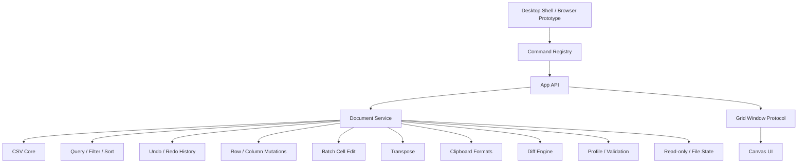

# opencsv Architecture v2

Status: Draft implementation architecture aligned to `docs/product-prd.md`

## 1. Goal

The current prototype proved the Go CSV core can open, preview, index, and save CSV files quickly. It also exposed the main product risk: UI behavior was implemented directly in event handlers without a product architecture.

Architecture v2 introduces stable boundaries:

- Core data services in Go.
- Document/session model in Go.
- Command registry shared by UI, CLI, and future desktop shell.
- Windowed grid protocol.
- Feature tests tied to PRD acceptance IDs.

## 2. Layers



## 3. Package Plan

### Existing

- `pkg/csvcore`
  - Format detection.
  - Encoding decode/encode.
  - Row indexing.
  - Preview.
  - Windowed reads.
  - Save/backup.
  - Minimal quote-policy detection aligned with the current Go CSV writer.

- `pkg/appserver`
  - Local HTTP API for browser prototype.
  - Static file serving.

### Implemented in Current Prototype

- `pkg/document`
  - Document sessions.
  - Source kind: path and upload.
  - Read-only session flag.
  - Last-known file size/mod-time tracking.
  - Edit overlay.
  - Full-record snapshot history for first-pass undo/redo.
  - Batch cell edits as a single undoable operation.
  - Row/column insert/delete materialized into temporary working copies.
  - Whole-document transpose as a guarded, undoable materialized mutation.
  - Dirty state.
  - File-status check and clean-document refresh from disk.
  - Window reads with edits applied.
  - Save policy.
  - Find, replace, contains-filter, SQL WHERE filter, and stable multi-column sort view mapping.
  - Column value frequency summaries and selected-value row filtering.

- `pkg/sqlexpr`
  - SQL WHERE subset parser/evaluator.
  - Header names and `c1`, `c2`, ... column references.
  - Comparisons, boolean operators, `LIKE`, `IS NULL`, arithmetic.
  - `CAST`/`TRY_CAST` and documented string/numeric/conditional function subset.

- `pkg/protocol`
  - `smoothcsv://file/...` deep-link parser.
  - CLI `--goto` location parser.
  - Row, cell, row-range, and cell-range coordinates.
  - Shared CSV format query parameter parsing.

- `cmd/opencsv`
  - Developer subcommands for open/inspect/generate/save/serve/bench.
  - Product root syntax `opencsv [options] [path ...]`.
  - Root CLI opens file targets and stdin (`opencsv -`), parses official goto/diff/format/window flags, and emits an invocation document for the current local prototype.

- `pkg/commands`
  - Command IDs and metadata.
  - Scope, shortcut, implementation status, and document requirements.
  - Shared source for toolbar state and future command palette.
  - Includes global commands for command palette and theme toggling.

- `pkg/csvdiff`
  - Row-level CSV comparison.
  - Cell-level changed values.
  - Added/deleted/changed/unchanged row statuses.
  - LCS anchors with changed-row pairing for common keyed CSV rows.

- `pkg/sqlconsole`
  - SQL Console query parsing/execution for the prototype.
  - Current document and local path source resolution.
  - `WHERE` delegation to `pkg/sqlexpr`.
  - Column projection, ordering, limiting, aggregate functions, and `GROUP BY`.

- `pkg/dataprofile`
  - Column profile metrics: dominant type, nulls, distinct count, min/max, numeric sum/average, and top values.
  - Data quality issues: empty headers, duplicate headers, ragged rows, and type anomalies.
  - Shared result model for `/api/profile`, the Profile view, and future CSVLint-compatible validation.

- `pkg/clipboard`
  - TSV, CSV, Markdown table, JSON, HTML table, SQL `VALUES`, LaTeX tabular, and raw value serialization.
  - TSV matrix parsing for spreadsheet-style paste.

- `web Profile View`
  - Summary, column profile table, issue table, and inspector integration.
  - First visual surface for validation work before full schema/rule editing exists.

- `web Command Palette`
  - Searchable command runner backed by `/api/commands`.
  - Honors implementation status and document requirements.
  - Dispatches first-pass handlers for open, save, undo, redo, find, replace, copy formats, row/column mutation, transpose, filter, sort, clear view, theme toggling, SQL, Profile, and Diff.

- `web Theme`
  - Light, dark, and system theme preferences.
  - Local preference persistence.
  - System color-scheme listener while preference is `system`.
  - CSS design tokens shared by DOM controls and Canvas grid rendering.

- `web Grid Selection`
  - Active cell plus anchor-based range selection.
  - Shift-arrow and Shift-click range expansion.
  - Batch editing of selected ranges through `/api/edit-batch`.
  - Numeric selection aggregation in the status bar.
  - Clipboard event handlers for TSV copy/paste and command handlers for CSV/Markdown/JSON/HTML/SQL/LaTeX/raw copy.
  - Active-cell value panel in the Inspector.
  - URL-like cell detection with an Open Link surface.
  - Frozen header layer with body clipping.
  - Format visibility in status/Inspector: encoding, delimiter, line ending, header mode, quote policy, and selected-cell quote state.
  - Per-cell quote indicators for values that will be quoted by the current minimal save policy.
  - Column header quick menu for replacing sort keys, appending secondary sort keys, selected-value filter, blank/non-blank SQL filters, and clear view.
  - Column value checklist inside the header quick menu.
  - Hidden SQL/Diff/Profile overlays explicitly use `[hidden]` display suppression so inactive panels cannot intercept grid input.

- `web Search Controls`
  - Find/Replace toolbar toggles for case sensitivity, whole-cell matching, and regex mode.
  - Toggles map directly to existing `/api/find` and `/api/replace` request options.

- `web File State`
  - Read-only toggle wired through command metadata and API state.
  - UI blocks edit/paste/save/undo/redo/replace/structural mutations while read-only, and backend APIs reject writes as the final guard.
  - File status polling detects external size/mod-time changes.
  - Clean editable documents refresh automatically; dirty or read-only documents surface the changed-on-disk state without overwriting local context.

### Planned

- `pkg/filter`
  - Value checklist model.
  - Filter chip composition and saved filter model.

- `pkg/search`
  - Rich find/replace history and UI state.
  - Search within selection and match-count streaming.
  - Regex/case/whole-cell command metadata.

- `pkg/sort`
  - Dedicated sorting worker package if sorting grows beyond `pkg/document`.
  - Text/number/date modes beyond the current string/numeric foundation.

- `pkg/sqlitebridge`
  - Future SQLite-compatible query execution.
  - Joins, grouping, aggregation, subqueries, and result documents.

- `web Diff View`
  - Prototype compare panel.
  - Left/right path inputs.
  - Summary and row/cell change table.

- `pkg/diffview`
  - Future side-by-side compare UI model.
  - Diff navigation.
  - Virtualized diff window protocol.

## 4. Document Model

```go
type SourceKind string

const (
    SourceFile SourceKind = "file"
    SourceUpload SourceKind = "upload"
    SourceStdin SourceKind = "stdin"
    SourceUntitled SourceKind = "untitled"
    SourceSQLResult SourceKind = "sql-result"
)

type Document struct {
    ID string
    SourceKind SourceKind
    DisplayName string
    OriginalPath string
    WorkingPath string
    Metadata csvcore.FileMetadata
    RowIndex csvcore.RowIndex
    HeaderRows int
    HeaderColumns int
    Dirty bool
    Edits EditOverlay
}
```

Rules:

- `OriginalPath` is where save writes by default for real files.
- `WorkingPath` is where the app reads from.
- Browser uploads use `SourceUpload`; default save writes to the temp copy unless the user chooses Save As.
- Desktop shell file opens use `SourceFile`; default save writes to original path.

## 5. API Contract

### Open

`POST /api/open`

Input:

- `path`
- `previewRows`
- `indexRows`

Output:

- document ID.
- document metadata.
- preview.
- row index summary.

### Upload Open

`POST /api/upload-open`

Input:

- multipart file.

Output:

- same as open.

### Window

`GET /api/window?id=...&start=...&count=...`

Output:

- row window with edits applied.

### Edit

`POST /api/edit`

Input:

- document ID.
- row.
- column.
- value.

Output:

- dirty state.

### Save

`POST /api/save`

Input:

- document ID.
- optional path.
- backup flag.

Output:

- saved path.
- backup path.
- size.

### Commands

`GET /api/commands`

Output:

- command metadata for toolbar, shortcut map, and future command palette.

### Read-only

`POST /api/read-only`

Input:

- document ID.
- read-only boolean.

Output:

- updated session.

### File Status

`GET /api/file-status?id=...`

Output:

- tracked path.
- current and last-known file size/mod-time.
- changed/missing state.
- dirty/read-only state.

### Refresh

`POST /api/refresh`

Input:

- document ID.

Output:

- refreshed session.

### Transpose

`POST /api/transpose`

Input:

- document ID.
- optional maximum cell limit.

Output:

- updated mutation result.
- refreshed session and row count.

### Diff

`POST /api/diff`

Input:

- `leftPath`.
- `rightPath`.
- optional `maxRows`.

Output:

- row-level diff.
- changed cells.
- summary counts.
- truncation flag.

### SQL

`POST /api/sql`

Input:

- `documentId` for `FROM current`.
- `query`.
- optional result limit.

Output:

- selected columns.
- result rows.
- total matched rows.
- source path.
- truncation flag.

### Filter

`POST /api/filter`

Input:

- document ID.
- `query` for contains filtering, or `mode: "sql"` plus `expression` for SQL WHERE filtering.
- optional column/case-sensitive settings for contains filtering.

Output:

- filtered row count.

### Column Values

`GET /api/column-values?id=...&column=...&limit=...`

Output:

- top distinct values.
- counts.
- total distinct count.

### Value Filter

`POST /api/filter-values`

Input:

- document ID.
- column.
- selected values.
- include blank flag.

Output:

- filtered row count.

## 6. Grid Rendering Rules

- Header is a fixed layer.
- Body rows are clipped to `y >= headerHeight`.
- Selection is clipped to body area.
- Row gutter is separate visual region.
- No body row may draw over header.
- Canvas dimensions are stable after resize.
- Header text uses fixed positions, not viewport-scaling font sizes.

## 7. Test Strategy

### Unit Tests

- Encoding round trips.
- Line ending preservation.
- Delimiter/header sniffing.
- Row boundary scanner.
- Save/backup.
- URL parser.
- CLI parser.
- CLI stdin target.

### API Tests

- Open path.
- Upload open.
- Window fetch.
- Edit and save.
- Backup preservation.
- Filter/sort/search endpoints.
- Undo/redo and row/column mutation endpoints.
- Batch edit endpoint.
- Clipboard formatter/parser unit tests for TSV, CSV, Markdown, JSON, HTML, SQL, LaTeX, raw, and TSV paste.
- Command registry endpoint.
- Theme command metadata.
- Find/Replace option request coverage.
- Diff endpoint.
- SQL endpoint.
- SQL aggregate query unit/API tests.
- Profile endpoint.

### Browser Tests

- Initial UI has no fake file.
- Open button opens the typed direct path when present, otherwise triggers the file chooser.
- Path Enter opens direct path.
- Header remains stable after wheel scroll.
- Quote indicators and Inspector quote state match minimal CSV save rules for delimiter, quote, CR/LF, and leading whitespace.
- Hidden panels do not intercept grid/header clicks.
- Column header quick menu can sort, filter by selected value, filter blanks, and clear the active view.
- Column header quick menu can append a secondary sort key and report the composed sort order.
- Column header value checklist can load distinct values with counts and filter by multiple selected values.
- Cell Value panel follows the active cell, applies edits through `/api/edit`, respects read-only mode, and exposes URL-like cell values as links.
- Read-only mode prevents frontend edit entry and backend writes.
- Clean documents auto-refresh from disk when the backing file changes.
- Transpose swaps rows and columns, marks the document dirty, is undoable, and rejects over-limit tables.
- Editing marks dirty.
- Save clears dirty and creates backup.
- Profile view shows column metrics and validation issues.
- Profile row selection updates the inspector.
- Command Palette can search and execute an enabled command.
- Command Palette can execute Insert Row, Undo, Redo, Insert Column, and Delete Column without modifying the original file before Save.
- Grid range selection can aggregate a 2x2 numeric range and edit all selected cells as one undoable batch.
- Command Palette exposes copy commands, and clipboard formatters preserve TSV/CSV/Markdown/JSON/HTML/SQL/LaTeX/raw output contracts.
- Command Palette can toggle dark mode, Canvas grid colors follow CSS variables, and the selected theme persists after reload.
- Find/Replace toggles can drive case-sensitive, whole-cell, and regex searches from the toolbar.
- SQL Console can execute `COUNT/SUM/AVG/MIN/MAX` with `GROUP BY` and order grouped output by an aggregate alias.

### Performance Tests

- 100 MB open first screen.
- 100 MB full index.
- 1 GB first screen.
- Grid scroll smoke with 1M logical rows.

### CLI Tests

- Interspersed root flags and paths.
- `--goto` with embedded file path and 1-based row/cell/range coordinates.
- `--diff` arity and stdin rejection.
- Delimiter, encoding, and header overrides mapped into `csvcore.OpenOptions`.
- `smoothcsv://file/...` URL parsing with format query parameters.

## 8. Immediate Refactor Sequence

1. Stabilize M1.1 browser prototype.
2. Extract appserver session logic into `pkg/document`.
3. Add command registry.
4. Make toolbar buttons command-driven.
5. Add feature flags for incomplete commands so UI never silently no-ops.
6. Add Browser regression checks.
7. Promote Profile/Validation foundation into CSVLint-compatible rule sets and quick fixes.
