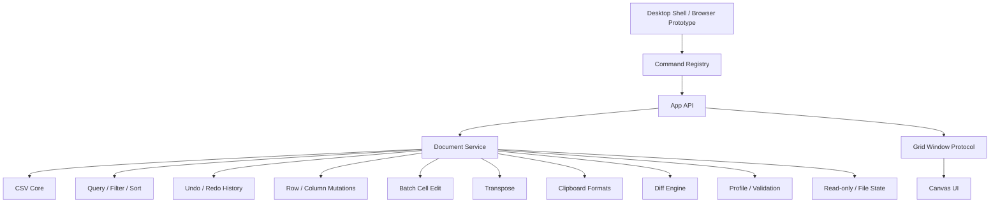

# opencsv Architecture v2

Status: Draft implementation architecture aligned to `docs/product-prd.md`

## 1. Goal

The current prototype proved the Go CSV core can open, preview, index, and save CSV files quickly. It also exposed the main product risk: UI behavior was implemented directly in event handlers without a product architecture.

Architecture v2 introduces stable boundaries:

- Core data services in Go.
- Document/session model in Go.
- Command registry shared by UI, CLI, and future desktop shell.
- Windowed grid protocol.
- Feature tests tied to PRD acceptance IDs.

## 2. Layers



## 3. Package Plan

### Existing

- `pkg/csvcore`
  - Format detection.
  - Encoding decode/encode.
  - Row indexing.
  - Preview.
  - Windowed reads.
  - Save/backup.
  - Minimal quote-policy detection plus full-index source quote-map scanning aligned with the current Go CSV writer.
  - Quote character, mode, and escape policy metadata for save/open workflows.

- `pkg/appserver`
  - Local HTTP API for browser prototype.
  - Static file serving.
  - Local update-check endpoint for Settings/manual check workflows; remote signed update feeds remain a desktop-shell concern.

### Implemented in Current Prototype

- `pkg/document`
  - Document sessions.
  - Source kind: path and upload.
  - Read-only session flag.
  - Last-known file size/mod-time tracking.
  - Edit overlay.
  - Full-record snapshot history for first-pass undo/redo, plus file-backed history snapshots for clean streaming current-column transforms.
  - Batch cell edits as a single undoable operation.
  - Row/column insert/delete/move materialized into temporary working copies.
  - View-only row hiding through source-row view mapping.
  - Whole-document transpose as a guarded, undoable materialized mutation.
  - Dirty state.
  - File-status check and clean-document refresh from disk.
  - Window reads with edits applied.
  - Save policy.
  - Find, replace, contains-filter, SQL WHERE filter, and stable multi-column sort view mapping.
  - Smart sort mode comparison for auto, number, date, text, and length.
  - Column value frequency summaries and selected-value row filtering.

- `pkg/sqlexpr`
  - SQL WHERE subset parser/evaluator.
  - Header names and `c1`, `c2`, ... column references.
  - Comparisons, boolean operators, `LIKE`, `IN`/`NOT IN`, `BETWEEN`/`NOT BETWEEN`, `IS NULL`, arithmetic.
  - `CAST`/`TRY_CAST`, exact bigint literals/casts/comparisons, typed temporal/interval literals, temporal interval arithmetic, signed composite interval quantities, interval field precision qualifiers, and documented string/numeric/conditional function subset.

- `pkg/protocol`
  - `smoothcsv://file/...` and `opencsv://file/...` deep-link parser.
  - CLI `--goto` location parser.
  - Row, cell, row-range, and cell-range coordinates.
- Shared CSV format query parameter parsing, including official case-insensitive URL spellings such as `quotemode`, `lineending`, `headerrows`, and `headercolumns`.

- `cmd/opencsv`
  - Developer subcommands for open/inspect/generate/save/serve/bench.
  - Product root syntax `opencsv [options] [path ...]`.
  - Root CLI opens file targets and stdin (`opencsv -`), parses official goto/diff/format/window flags, and emits an invocation document plus browser-prototype route for the current local prototype.
  - CLI grep scans cells with optional case-insensitive, regex, column-targeted, and limited JSON output.

- `pkg/commands`
  - Command IDs and metadata.
  - Scope, shortcut, implementation status, and document requirements.
  - Shared source for toolbar state, command palette availability, shortcut defaults, and context-aware shortcut conditions.
  - Includes global commands for command palette and theme toggling.

- `pkg/csvdiff`
  - Row-level CSV comparison.
  - Cell-level changed values.
  - Added/deleted/changed/unchanged row statuses.
  - LCS anchors with changed-row pairing for common keyed CSV rows.
  - Optional explicit key-column row alignment for reordered CSV records.

- `pkg/sqlconsole`
  - In-memory SQLite execution for SQL Console queries.
  - Current document, direct quoted path, `@file:`, and `file://` source resolution.
  - Text-backed temporary tables that preserve the documented CSV-as-text semantics.
  - SQLite-owned projection, joins, subqueries, expressions, `GROUP BY`, `HAVING`, ordering, and limits.
  - Frontend-local query history stores successful SQL text and can reload it into the editor.

- `pkg/dataprofile`
  - Column profile metrics: dominant type, nulls, distinct count, min/max, numeric sum/average, and top values.
  - Data quality issues: empty headers, duplicate headers, ragged rows, and type anomalies.
  - User-supplied schema rules for required values, primitive type checks, uniqueness, enum values, regular-expression patterns, numeric ranges, and string length ranges.
  - Schema JSON normalization for `/api/profile`, accepting opencsv `columns` plus common CSVLint/JSON Table Schema/Frictionless `fields`, `constraints`, `datatype`, `default`, `schema`, `tableSchema`, first-table schema, and first-resource schema shapes.
  - Issue metadata includes source location, rule name, actual/expected widths for ragged rows, and safe quick-fix descriptors with optional target values where available.
  - Shared result model for `/api/profile`, the Profile view, and future richer CSVLint-compatible validation.

- `pkg/clipboard`
  - TSV, CSV, Markdown table, JSON, HTML table, SQL `VALUES`, LaTeX tabular, and raw value serialization.
  - Header-row prepending for selected-column copy workflows.
  - TSV matrix parsing for spreadsheet-style paste.
  - Shared formatter contracts used by selection copy and rich current-view export downloads.

- `web Profile View`
  - Summary, column profile table, issue table, and inspector integration.
  - Schema JSON editor with local save/reset controls and URL boot support via `profileSchema=` plus `profileRun=1`; input accepts normalized opencsv schemas plus common CSVLint/JSON Table Schema/Frictionless `fields`/`constraints`/`datatype`/`tableSchema`/`resources` shapes.
  - Named local profile schema library with apply/delete/export/import controls and URL boot saving via `profileSchemaName=` plus `profileSchemaSave=1`.
  - Visual schema rule builder for column name/number, type, required, unique, enum, regex pattern, and numeric range checks; each builder action keeps the JSON schema source in sync.
  - Problems rows navigate back to the grid selection, and safe quick-fix buttons, including deterministic numeric range clamps, single-value enum replacements, and required-field defaults, dispatch through the existing edit-batch mutation path.

- `web Command Palette`
  - Searchable command runner backed by `/api/commands`.
  - Fuzzy command scoring across command ID, title, description, and aliases.
  - Local recent command history shared by palette/toolbar/shortcut dispatch.
  - Keyboard Shortcuts stores backward-compatible string bindings plus object bindings with optional `when` contexts or boolean `when` expressions; conflict detection allows the same shortcut in non-overlapping contexts and runtime dispatch checks the active Grid/SQL/Profile/Settings/Diff/typing state.
  - Official Filter entrypoint uses `Cmd+Shift+F`/`Ctrl+Shift+F` in command metadata and runtime dispatch.
  - Honors implementation status and document requirements.
  - Dispatches first-pass handlers for open, save, undo, redo, find, replace, copy formats, row/column insert/delete/move/hide, transpose, duplicate-row/column removal, selected-cell and column text transforms, join/split cell tools, filter, sort, clear view, theme toggling, SQL, Profile, and Diff.

- `web Theme`
  - Light, dark, and system theme preferences.
  - Local preference persistence.
  - System color-scheme listener while preference is `system`.
  - CSS design tokens shared by DOM controls and Canvas grid rendering.

- `web Link Policy`
  - Local allow-list for safe custom cell-link protocols.
  - Trusted standard schemes remain built in, unsafe schemes are always blocked, and unknown custom schemes stay disabled until allowed in Settings.

- `web Settings`
  - Section-level search over settings categories, controls, summaries, saved views, and format presets.
  - Section-level modified/default badges backed by per-category preference checks plus `body[data-settings-modified-sections]` diagnostics.
  - Empty-state feedback when no settings section matches.
  - Saved/recent filter controls share the saved-view settings section, including configurable recent-filter retention and clear-history action.
  - Language preference controls with a reusable locale catalog and persisted locale selection for target SmoothCSV locales.
  - Update check mode controls for automatic, manual-only, and off states, with startup checks gated by the persisted mode.

- `web Internationalization`
  - Locale catalog with English fallback and target locale entries for Japanese, French, Spanish, Italian, Simplified Chinese, Portuguese, Russian, German, and Korean.
  - App chrome labels, start/recent file actions, settings headings, placeholders, active filter/sort chips, filter/sort statuses, column header menu labels/value-list states, saved-view statuses, and idle status route through a translation helper instead of being fixed in rendering code.
  - `document.documentElement.lang` and `body[data-locale]` mirror the active locale for accessibility and Browser verification.

- `web Start / Recent Files`
  - Sidebar start surface with path-input focus and browser file-picker quick actions.
  - Local recent file persistence for path-opened files.
  - Recent entry reopen flow and missing-file cleanup on failed reopen.
  - Session-backed open file tab list for already-open files; sidebar tab switching uses `/api/session` and `/api/window` so dirty edit overlays remain attached to the original document session instead of reopening the path from disk.
  - Clean open tabs can be closed through `/api/close`; dirty tabs are rejected unless a caller passes an explicit force/discard path.
  - The sidebar file list owns its vertical overflow and scrolls the active open tab into view after render so multi-file sessions do not stretch the app shell.

- `web Editor Groups`
  - First split-editor group state for primary and secondary editor groups.
  - Horizontal/vertical group layout toggling with active-group focus tracking.
  - Open-file tabs carry editor-group ownership, and each group keeps its own active tab so focusing a group restores that session.
  - Current or group-owned document tabs can move between editor groups by command, tab context menu, and mouse-drag drop while preserving selection.
  - The canvas grid frame is mounted into the group that owns the active tab; empty groups render lightweight placeholders while richer arbitrary tab-strip management remains planned.
  - Workbench commands dispatch split, orientation, focus, tab move, and close actions.

- `web SQL Console`
  - SQL editor, run button, query history row, and result table.
  - Newest-first local history for successful queries.
  - History item reload and clear-history controls.
  - Click/Shift-click rectangular result selection, with Copy CSV using the selected range when present.

- `web Grid Selection`
  - Active cell plus anchor-based range selection.
  - Shift-arrow and Shift-click range expansion.
  - Cmd/Ctrl mouse drag adds a range to Smart Selection; Cmd/Ctrl+Shift mouse drag subtracts the range from the current multi-range selection.
  - Batch editing of selected ranges through `/api/edit-batch`.
  - Numeric selection aggregation in the status bar.
  - Clipboard event handlers for TSV copy/paste and command handlers for TSV-with-headers, CSV, Markdown, JSON, HTML, SQL, LaTeX, and raw copy.
  - Selected-cell and column text transforms for trim, uppercase/lowercase, naming/case conversions, full-width/half-width conversion, and Unicode NFC/NFD/NFKC/NFKD normalization with explicit source-cell mapping.
  - Grid context menu dispatches rich copy, text transform, quote, fill, swap, join/split, transpose, dedupe, row, column, filter, and sort commands through shared command IDs, and preserves an existing selected range when right-clicking inside it.
  - Selected column headers can be dragged to reorder visible columns through the existing `/api/column/move` mutation path.
  - Selected row headers can be dragged to reorder data rows through the existing `/api/row/move` mutation path.
  - Swap Cells for exactly two selected cells, plus active-cell neighbor swap commands for up/down/left/right.
  - Horizontal Join Cells and Split Cell commands backed by document mutations.
  - Active-cell value panel in the Inspector.
  - URL-like cell detection with an Open Link surface.
  - Single-canvas sticky header redraw with body clipping.
  - Ragged short-row rendering that distinguishes source-missing cells from real blank cells.
  - Format visibility in status/Inspector: encoding, delimiter, line ending, header mode, quote policy, and selected-cell quote state.
  - Per-cell quote indicators for values that will be quoted by the current minimal save policy.
  - Column header quick menu for replacing sort keys, appending secondary sort keys, selected-value filter, blank/non-blank SQL filters, and clear view.
  - Hidden source-column state persists per local file path and is restored on reopen while rejecting stale or all-hidden column sets.
  - Recent and saved filter dropdown for replaying toolbar, SQL, value-checklist, and saved filter expressions without retyping.
  - Filter Builder can generate adjacent nested condition groups such as `A AND (B OR C)`, duplicate/reorder/group/ungroup additional condition rows, and emit direct list predicates such as `region IN (...)` before handing the SQL expression to the shared filter evaluator.
  - Builder-created active filters keep normalized condition rows, so active chips, recent filters, and saved filters can reopen the visual Builder while SQL-only filters continue to hand off to SQL Console.
  - Length-based column sort entry point and frontend sort-mode inference for numeric/date-looking columns.
  - Column value checklist inside the header quick menu.
  - View-only hidden columns through visible-column to source-column mapping.
  - Hidden SQL/Diff/Profile overlays explicitly use `[hidden]` display suppression so inactive panels cannot intercept grid input.

- `web Search Controls`
  - Find/Replace toolbar toggles for case sensitivity, whole-cell matching, regex mode, and search within selection.
  - Toggles map directly to existing `/api/find` and `/api/replace` request options.
  - Find requests expose elapsed-time progress, completion/cancel timing, and streaming diagnostics through status text plus `body` data attributes.
  - Search-in-selection sends explicit selected source-cell scopes and keeps that original scope while match navigation changes the active cell.
  - Find/Replace command routing seeds the query from selected inline-editor text, Cell Value panel text, detached cell-dialog text, or the active grid cell when the Find box is empty.
  - Single Replace scopes `/api/replace` to the active Find match cell when the cached find criteria still match the toolbar query; Replace All preserves the full-document or selection scope.
  - Match count display plus Previous/Next navigation for the current result window.

- `web File State`
  - Read-only toggle wired through command metadata and API state.
  - UI blocks edit/paste/save/undo/redo/replace/structural mutations while read-only, and backend APIs reject writes as the final guard.
  - File status polling detects external size/mod-time changes.
  - Clean editable documents refresh automatically; dirty or read-only documents surface the changed-on-disk state without overwriting local context.

### Planned

- `pkg/filter`
  - Value checklist model.
  - Filter chip composition and saved filter model.

- `pkg/search`
  - Rich find/replace history and UI state.
  - Match-count streaming.
  - Regex/case/whole-cell command metadata.

- `pkg/sort`
  - Dedicated sorting worker package if sorting grows beyond `pkg/document`.
  - Text/number/date modes beyond the current string/numeric foundation.

- `pkg/sqlitebridge`
  - Future streaming/virtual-table adapter if in-memory row loading is not enough for 1 GB-scale queries.
  - Future SQL result document/session model for editable or exportable query outputs.

- `web Diff View`
  - Prototype compare panel.
  - Left/right path inputs.
  - Summary and row/cell change table.

- `pkg/diffview`
  - Future side-by-side compare UI model.
  - Diff navigation.
  - Virtualized diff window protocol.

## 4. Document Model

```go
type SourceKind string

const (
    SourceFile SourceKind = "file"
    SourceUpload SourceKind = "upload"
    SourceStdin SourceKind = "stdin"
    SourceUntitled SourceKind = "untitled"
    SourceSQLResult SourceKind = "sql-result"
)

type Document struct {
    ID string
    SourceKind SourceKind
    DisplayName string
    OriginalPath string
    WorkingPath string
    Metadata csvcore.FileMetadata
    RowIndex csvcore.RowIndex
    HeaderRows int
    HeaderColumns int
    Dirty bool
    Edits EditOverlay
}
```

Rules:

- `OriginalPath` is where save writes by default for real files.
- `WorkingPath` is where the app reads from.
- Browser uploads use `SourceUpload`; default save writes to the temp copy unless the user chooses Save As.
- Desktop shell file opens use `SourceFile`; default save writes to original path.

## 5. API Contract

### Open

`POST /api/open`

Input:

- `path`
- `previewRows`
- `indexRows`
- optional format overrides: delimiter, quote character/mode/escape, encoding, line ending, header rows, and header columns, accepting official URL aliases case-insensitively.

Output:

- document ID.
- document metadata.
- preview.
- row index summary.

`POST /api/delimiter`

Input:

- `documentId`
- `delimiter`
- optional `delimiterName`

Output:

- mutation result with refreshed document metadata and dirty state.

`POST /api/encoding`

Input:

- `documentId`
- `encodingName`

Output:

- mutation result with refreshed document metadata and dirty state.

Notes:

- The document manager reads existing records with the current dialect before materializing a new working copy with the requested delimiter, preventing delimiter policy changes from causing later saves to parse the old file with the new separator.

### Upload Open

`POST /api/upload-open`

Input:

- multipart file.

Output:

- same as open.

### Session

`GET /api/session?id=...`

Output:

- session snapshot, document metadata, dirty state, and read-only state.

`POST /api/close`

Input:

- document ID.
- optional force flag for explicit discard/close flows.

Output:

- closed document ID and dirty/read-only source metadata.

Behavior:

- dirty sessions return an error unless `force` is true.
- closed sessions are removed from the manager and no longer resolve through `/api/session`.

### Window

`GET /api/window?id=...&start=...&count=...`

Output:

- row window with edits applied.

### Edit

`POST /api/edit`

Input:

- document ID.
- row.
- column.
- value.

Output:

- dirty state.

### Save

`POST /api/save`

Input:

- document ID.
- optional path.
- backup flag.

Output:

- saved path.
- backup path.
- size.

### Backups

`GET /api/backups?id=...`

Output:

- timestamped backup list for the current document path.
- backup path, name, size, and modified time.

`POST /api/restore-backup`

Input:

- document ID.
- backup path from the current document backup list.

Output:

- updated mutation result.
- refreshed session and row count.

### Commands

`GET /api/commands`

Output:

- command metadata for toolbar, shortcut map, and future command palette.

### Read-only

`POST /api/read-only`

Input:

- document ID.
- read-only boolean.

Output:

- updated session.

### File Status

`GET /api/file-status?id=...`

Output:

- tracked path.
- current and last-known file size/mod-time.
- changed/missing state.
- dirty/read-only state.

### Refresh

`POST /api/refresh`

Input:

- document ID.

Output:

- refreshed session.

### Row and Column Mutations

`POST /api/row/insert`
`POST /api/row/delete`
`POST /api/row/move`
`POST /api/row/hide`
`POST /api/column/insert`
`POST /api/column/delete`
`POST /api/column/move`

Input:

- document ID.
- row or column index.
- move delta for move endpoints.

Output:

- updated mutation result.
- refreshed session and row count.

Frontend command dispatch uses this endpoint for whole-table transpose. Known whole-table transposes at or above the confirmation threshold open a confirmation dialog with row, column, and cell counts before calling the endpoint; the endpoint remains the hard max-cell guard. When one or more multi-cell rectangular grid ranges are active, the same `table.transpose` command transposes those selected ranges through `/api/edit-batch` so the operation stays undoable without materializing the whole document. Multi-range transpose requires each range's source/target union to stay disjoint from the others. If a transposed selected-range target extends past the current rightmost visible column or bottom data row, the frontend grows the visible model and `/api/edit-batch` records the higher source column and row counts so the expanded target can be saved.

Rules:

- Row move preserves detected header rows and will not move data rows above the header.
- Column move preserves the first row values as ordinary cells, moving headers and column data together.
- Boundary moves are clean no-ops.
- Mutations are materialized into the working copy and remain undoable before Save.
- Row hide is view-only, does not mark the document dirty, and can be restored with Clear View.
- Column hide is currently a frontend view-only mapping that preserves source column indexes for edit, sort, filter, copy, profile, and transform actions. It can be restored with Clear View.

### Transpose

`POST /api/transpose`

Input:

- document ID.
- optional maximum cell limit.

Output:

- updated mutation result.
- refreshed session and row count.

### Duplicate Rows and Columns

`POST /api/dedupe-rows`

Input:

- document ID.

Output:

- updated mutation result.
- refreshed session and row count.
- changed count for removed duplicate rows.

Rules:

- The detected header row is preserved and excluded from duplicate matching.
- The mutation is undoable and only marks the document dirty when at least one duplicate row is removed.

`POST /api/dedupe-columns`

Input:

- document ID.

Output:

- updated mutation result.
- refreshed session and row count.
- changed count for removed duplicate columns.

Rules:

- Duplicate columns are compared by full cell values, including header cells when present.
- Later duplicate columns are removed while preserving the original order of the first unique columns.
- The mutation is undoable and only marks the document dirty when at least one duplicate column is removed.

### Text Transform

`POST /api/text-transform`

Input:

- document ID.
- mode: `trim`, `upper`, `lower`, `snake`, `kebab`, `camel`, `pascal`, `title`, `wide`, `narrow`, `nfc`, `nfd`, `nfkc`, or `nfkd`.
- either explicit source cells with zero-based row and column indexes, or one zero-based source column for current-column transforms.

Output:

- updated mutation result.
- refreshed session and row count.
- changed count for cells whose value changed.
- optional `streamed:true` when a clean-file current-column transform used the streaming read/write path.

Rules:

- Transform commands are read-only-safe: they reject read-only sessions.
- Duplicate cells in the request are applied once.
- Current-column transforms skip detected header rows.
- Clean UTF-8/UTF-8-BOM current-column transforms with standard double-quote escaping stream records into a rewritten working file while preserving line endings and quote policy; the pre-transform undo history is stored as a copied working-file snapshot instead of a full in-memory record slice. Dirty/edit-overlay, workbook, legacy encoding, and non-standard quote-escape sessions fall back to materialized records.
- Empty no-op transforms do not create an undo entry or mark the document dirty.
- Frontend command execution reuses localized command titles for selected-cell and current-column status messages.

### Cell Tools

`POST /api/cells/swap`
`POST /api/cells/join`
`POST /api/cells/split`

Input:

- document ID.
- explicit source cells with zero-based row and column indexes.
- separator text for join/split, supplied from the Inspector cell-tool separator preference.
- optional `allowOverwrite` for split requests that intentionally replace non-empty target cells.

Output:

- updated mutation result.
- refreshed session and row count.
- changed count for cells whose value changed.

Rules:

- Swap requires exactly two source cells and exchanges their values; the frontend can provide those cells either from an explicit two-cell selection or from active-cell neighbor swap commands.
- Join groups selected cells by row, sorts columns left-to-right, writes the joined text into the first selected cell using the configured separator, and clears the remaining selected cells in that row.
- Split writes separator-delimited parts horizontally or vertically starting at the selected source cell using the configured separator, can expand row width or row count, and rejects non-empty target cells unless `allowOverwrite` is explicitly set.
- Cell tools are materialized, undoable mutations and preserve source-column targeting when frontend columns are hidden.

### Diff

`POST /api/diff`

Input:

- `leftPath`.
- `rightPath`.
- optional `rightText` and `rightLabel` for comparing against pasted/clipboard text.
- optional `maxRows`.
- optional `keyColumn`, either a header name or a 1-based column number, for row alignment before change detection.

Output:

- row-level diff.
- changed cells.
- summary counts.
- truncation flag.
- compare options: ignore case, ignore whitespace, ignored columns, header-name column alignment, and key-column row alignment.
- inline character-level spans for changed cells.

`POST /api/diff-merge`

Input:

- `leftPath`.
- `rightPath`.
- optional `rightText` and `rightLabel` for applying pasted/clipboard text to the left file.
- `resultIndex`.
- `mode`: `row` or `cell`.
- optional `col` for cell merge.
- optional `direction`: `right-to-left` by default, or `left-to-right` for two real files.
- same compare options as `/api/diff`.

Output:

- applied merge kind.
- save result and backup path.

### SQL

`POST /api/sql`

Input:

- `documentId` for `FROM current`.
- `query`.
- optional result limit.

Output:

- selected columns.
- result rows.
- total matched rows.
- source path.
- truncation flag.

### Filter

`POST /api/filter`

Input:

- document ID.
- `query` for contains filtering, or `mode: "sql"` plus `expression` for SQL WHERE filtering.
- optional column/case-sensitive settings for contains filtering.

Output:

- filtered row count.

### Column Values

`GET /api/column-values?id=...&column=...&limit=...`

Output:

- top distinct values.
- counts.
- total distinct count.

### Value Filter

`POST /api/filter-values`

Input:

- document ID.
- column.
- selected values.
- include blank flag.

Output:

- filtered row count.

## 6. Grid Rendering Rules

- Header is a fixed layer.
- Body rows are clipped to `y >= headerHeight`.
- Vertical wheel movement is accumulated and applied in whole-row steps so body text never appears as a clipped partial row directly under the frozen header.
- Selection is clipped to body area.
- Large selections render only the visible row/column intersection, and aggregate statistics fall back to a count-only summary past the synchronous sample limit.
- Row gutter is separate visual region.
- No body row may draw over header.
- Canvas dimensions are stable after resize.
- Header text uses fixed positions, not viewport-scaling font sizes.

## 7. Test Strategy

### Unit Tests

- Encoding round trips.
- Line ending preservation.
- Delimiter/header sniffing.
- Row boundary scanner.
- Save/backup.
- Backup list/restore endpoints.
- URL parser.
- CLI parser.
- CLI stdin target.
- CLI grep command.

### API Tests

- Open path.
- Upload open.
- Window fetch.
- Edit and save.
- Backup preservation.
- Filter/sort/search endpoints.
- Undo/redo and row/column insert/delete/move/hide endpoints.
- Batch edit endpoint.
- Clipboard formatter/parser unit tests for TSV, CSV, Markdown, JSON, HTML, SQL, LaTeX, raw, header prepending, and TSV paste.
- Command registry endpoint.
- Theme command metadata.
- Find/Replace option request coverage.
- Scoped current-match Replace request coverage.
- Find detailed total/truncation coverage.
- Diff endpoint.
- SQL endpoint.
- SQL aggregate query unit/API tests.
- Profile endpoint, including direct CSVLint/JSON Table Schema request decoding.

### Browser Tests

- Initial UI has no fake file.
- Browser prototype can boot-open a local direct path from `?open=/absolute/path.csv` for launch and regression workflows, including repeated `open` params for CLI multi-file handoff and CLI stdin routes that pass a temporary path with `stdin=1`.
- Multi-open boot keeps opened document sessions in the sidebar open tab list; switching back to a prior tab restores its session snapshot and loaded window rather than re-reading the file path.
- Sidebar open tab close removes clean sessions, switches to a remaining tab or start surface, and blocks dirty closes without an explicit discard path.
- A long sidebar open-tab list remains contained within the viewport, reports overflow state for regression checks, and keeps the active tab visible after multi-open boot and tab switching.
- Open button opens the typed direct path when present, otherwise triggers the file chooser.
- Path Enter opens direct path.
- Sidebar start surface can reopen recent files and removes a missing recent entry when reopening fails.
- Header remains stable after wheel scroll.
- Body drag, row-label click, column-header click, and header-in-selection shortcut update the selection range without breaking the column menu glyph.
- Cmd/Ctrl hover over URL cells sets a pointer cursor and title tooltip, then clears both when the modifier key is released.
- Diff View can boot from URL parameters for regression and protocol workflows, including compare options and immediate run.
- Diff View URL boot can pass `diffKeyColumn` and align reordered files by that key before reporting changed rows.
- Diff View marks changed/added/deleted result rows as navigable differences, supports next/previous buttons, and supports the Alt+F5 / Shift+Alt+F5 shortcut shape used by SmoothCSV.
- Diff View merge actions call a backend merge endpoint that recomputes the diff, applies the selected row or cell in either file direction, creates a backup, and atomically saves the target file.
- Diff View can compare against pasted right-side CSV text, load right-side text from the browser clipboard when available, and use the same merge actions to apply that text to the left file.
- Quote indicators and Inspector quote state match active CSV save rules for delimiter, quote, quote escape, CR/LF, and leading whitespace.
- Hidden panels do not intercept grid/header clicks.
- Column header quick menu can sort, filter by selected value, filter blanks, and clear the active view.
- Column header quick menu can append a secondary sort key and report the composed sort order.
- Column header value checklist can load distinct values with counts and filter by multiple selected values.
- Cell Value panel follows the active cell, applies edits through `/api/edit`, respects read-only mode, and exposes URL-like cell values as links.
- Link protocol Settings can allow or reset custom cell-link protocols without enabling unsafe schemes.
- Read-only mode prevents frontend edit entry and backend writes.
- Clean documents auto-refresh from disk when the backing file changes.
- Transpose swaps rows and columns for the whole table, or transposes one or more non-overlapping rectangular selected ranges through batch edits; known large whole-table transposes show a confirmation dialog, and selected-range targets may expand rightward into new columns or downward into new rows. Both paths mark the document dirty and remain undoable.
- Duplicate-row/column removal and selected-cell/column text transforms are command-backed, undoable mutations; current-column transforms use a streaming path plus file-backed undo snapshot for clean UTF-8 files when safe and fall back to materialized records otherwise.
- Swap/join/split cell tools are command-backed, undoable materialized mutations; split protects non-empty targets by default and keeps an explicit overwrite path for callers that need it.
- Hidden rows/columns are view-only and restored by Clear View.
- Editing marks dirty.
- Save clears dirty and creates backup.
- Restore From Backup materializes a selected timestamped backup into the current session, marks it dirty, and keeps the backing file unchanged until Save.
- Profile view shows column metrics and validation issues.
- Profile row selection updates the inspector.
- Profile validation can run saved or URL-supplied schema rules, manage named local schema sets, edit common rules visually, quick-fix short ragged rows, clamp deterministic numeric range violations, replace single-value enum violations, and fill required blanks from schema defaults through edit-batch mutations.
- Command Palette can search and execute an enabled command.
- Command Palette fuzzy search ranks `Profile` first for `pf`, and empty-query results prioritize recently executed commands.
- Command Palette can execute Insert Row, Undo, Redo, Insert Column, Delete Column, and move/hide row/column commands without modifying the original file before Save.
- Keyboard Shortcuts can import boolean `when` expressions such as `grid && !typing` or `sql || settings`, preserve them on export, and dispatch only when the expression matches the active app context.
- Grid range selection can aggregate a 2x2 numeric range and edit all selected cells as one undoable batch.
- Command Palette exposes copy commands, and clipboard formatters preserve TSV/CSV/Markdown/JSON/HTML/SQL/LaTeX/raw output contracts.
- Copy with Headers prepends selected column labels before formatting the selected matrix.
- Export View can download the current filtered/sorted/visible-column view as CSV, TSV, Markdown, JSON, HTML, SQL, LaTeX, raw text, or XLSX.
- XLSX open can enumerate workbook sheets, select a worksheet by name or 1-based index through `/api/open`, URL boot parameters, and the status-bar worksheet selector, and save edits to the selected worksheet while preserving the other worksheet entries on normal save or Save As to a new workbook path. Selected-sheet saves preserve existing row/cell attributes, formula nodes, and worksheet-level structures such as column metadata and merged cells where the original worksheet XML can be parsed.
- XLSX import parses shared/inline strings, booleans, sparse references, cached formula values, and basic `styles.xml` date/time number formats into grid-friendly text.
- Command Palette can toggle dark mode, Canvas grid colors follow CSS variables, and the selected theme persists after reload.
- Find/Replace toggles can drive case-sensitive, whole-cell, regex, and selection-scoped searches from the toolbar.
- Find toolbar shows current/total match count and navigates previous/next matches.
- Replace after Find Next targets the active match cell instead of the first matching cell in the file.
- Find/Replace can seed the toolbar query from selected cell/editor text through shortcut, toolbar, and command-palette dispatch.
- SQL Console delegates execution to in-memory SQLite and supports joins, expression projection, subqueries, `GROUP BY`, `HAVING`, and ordering by an expression alias.
- SQL Console frontend requests use an elapsed-time progress state that updates running status text, records `data-sql-elapsed-ms`, and keeps final elapsed time on completion or cancellation.
- SQL Console stores successful query history, reloads a selected query into the editor, and clears local query history.
- SQL Console result table supports rectangular range selection and selected-range CSV copy through the existing Copy CSV command.

### Performance Tests

- 100 MB open first screen.
- 100 MB full index.
- 1 GB first screen.
- Grid scroll smoke with 1M logical rows.

### CLI Tests

- Interspersed root flags and paths.
- `--goto` with embedded file path and 1-based row/cell/range coordinates.
- `--diff` arity and stdin rejection.
- `--diff` invocation emits a web route/URL that boots the browser Diff View with `diffLeft`, `diffRight`, and `diffRun=1`.
- `--diff --goto <side-file>:row:col` emits `diffGotoSide` and `diffGoto`; Browser URL boot activates the matching changed/added/deleted diff row after compare.
- Multiple root file paths emit repeated `open`, `openSource`, `openName`, and `openGoto` params; the browser prototype opens them sequentially and leaves the final or goto-target file active while prior files remain in Recent.
- `opencsv -` emits a retained temporary route path plus `stdin=1`/`source=stdin` so the browser prototype opens the piped data as a temporary stdin source.
- Delimiter, encoding, line-ending, quote character/mode, and header overrides mapped into `csvcore.OpenOptions`, including official URL aliases for generated Browser routes.
- `smoothcsv://file/...` and `opencsv://file/...` URL parsing with format query parameters.

## 8. Immediate Refactor Sequence

1. Stabilize M1.1 browser prototype.
2. Extract appserver session logic into `pkg/document`.
3. Add command registry.
4. Make toolbar buttons command-driven.
5. Add feature flags for incomplete commands so UI never silently no-ops.
6. Add Browser regression checks.
7. Promote Profile/Validation foundation into CSVLint-compatible rule sets and quick fixes.
