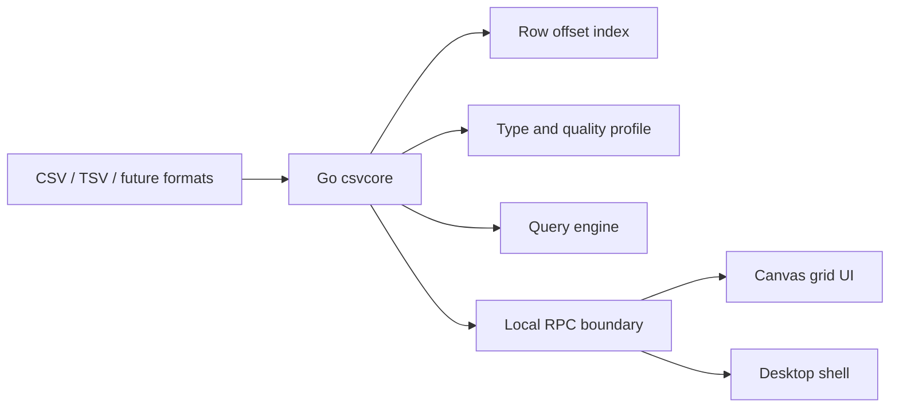

# Architecture

## Direction

opencsv is organized around a Go core and a high-performance grid UI.

## Core Principles

- First screen fast: parse enough to show data, then continue indexing in the background.
- Raw fidelity: preserve delimiter, quoting, BOM, encoding, and line endings unless the user asks to normalize.
- Typed views: types help filtering and SQL, but raw cell values remain available.
- Cancelable work: indexing, profiling, sorting, and querying must be cancellable.
- Narrow UI boundary: frontend asks for windows of cells, column metadata, and operations; it does not own parsing.

## Go Packages

`pkg/csvcore` currently owns:

- `Sniff`: delimiter, BOM, column count, and header heuristics.
- `OpenPreview`: first-screen records without whole-file load.
- `BuildRowIndex`: record start byte offsets using `encoding/csv.Reader.InputOffset`.
- `GenerateSynthetic`: deterministic benchmark data.

Planned packages:

- `pkg/table`: immutable table window protocol and edit overlay.
- `pkg/profile`: type inference, nulls, distinct counts, min/max, invalid samples.
- `pkg/query`: SQL execution over current files.
- `pkg/project`: workspace, recent files, settings, and session state.
- `pkg/rpc`: JSON-RPC or Connect/gRPC bridge to the UI.

## Desktop Shell Options

Wails is the leading candidate for a Go-native desktop shell. Tauri remains possible with Go as a sidecar, but that gives up the simplicity of a mostly Go stack. The M1 decision should be based on file dialog quality, menu integration, packaging friction, and UI RPC ergonomics.
